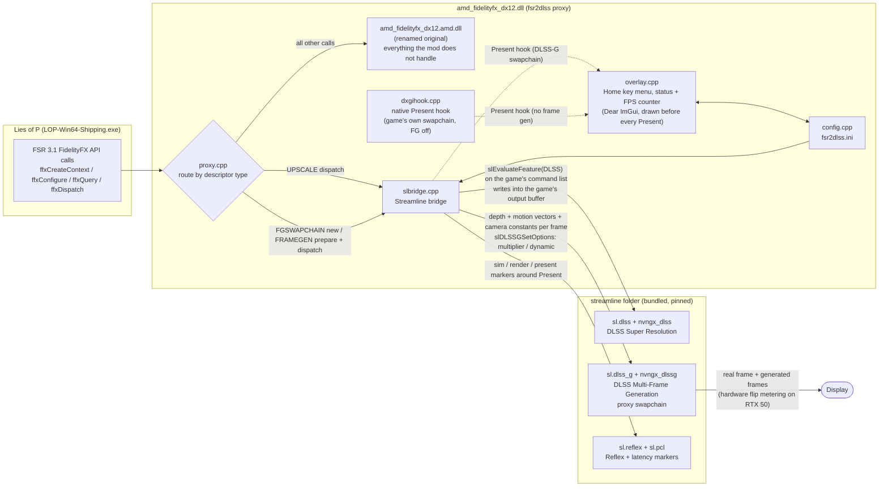
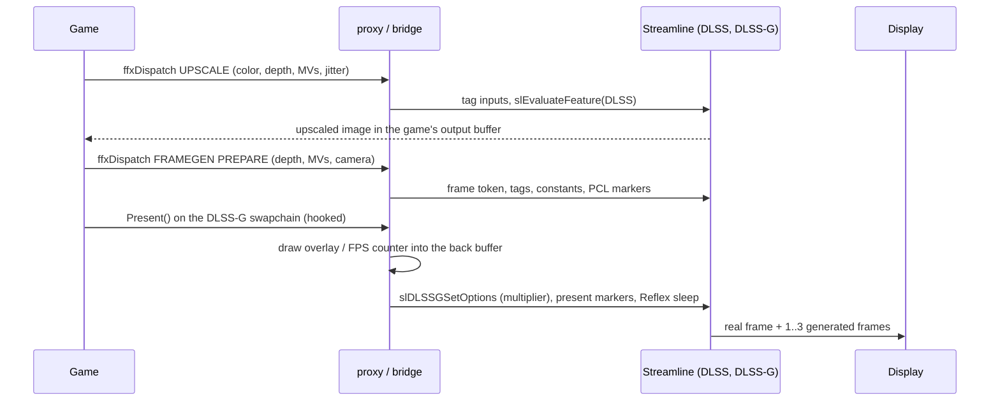

# fsr2dlss

Replaces AMD FSR 3.1 with NVIDIA DLSS. The game's upscaling becomes DLSS Super Resolution and its
frame generation becomes DLSS Multi-Frame Generation, all driven through NVIDIA Streamline. Built and
tested on an RTX 5090.

The mod is a proxy for `amd_fidelityfx_dx12.dll`. The game loads it by name, so it forwards the
calls it doesn't care about to the renamed real AMD DLL and translates the upscale and
frame-generation work to Streamline. As far as the game is concerned it is still running FSR; DLSS
runs underneath it.

## How it works



The game keeps calling FSR. The proxy answers the five FidelityFX exports: the upscale pass is
redirected to DLSS Super Resolution, the frame-generation swapchain the game asks for is replaced by
Streamline's DLSS-G swapchain (so every real frame the game presents comes out as 2, 3 or 4 frames),
and anything else goes to the renamed original AMD DLL. The overlay draws from whichever Present hook
is live: the bridge's while the DLSS-G swapchain exists, a native DXGI hook otherwise. Both it and the
bridge read one configuration.



## What you get

- DLSS Super Resolution instead of FSR, with the DLSS 310 transformer models. By default the DLSS
  quality mode follows the in-game FSR preset (native resolution gives DLAA); the mode and the model
  preset (K, J, L, M) can be overridden.
- DLSS Frame Generation. On an RTX 50-series card this is true 3x/4x Multi-Frame Generation on
  Blackwell hardware flip metering (roughly 75 fps rendered turns into 225 fps displayed), or Dynamic
  Multi-Frame Generation that targets your refresh rate.
- An in-game overlay on **Home** (configurable), available from the moment the game starts whether or
  not FSR or frame generation is on. It shows the mod's status (is the game issuing FSR calls, did the
  original AMD DLL load, is Streamline up, which swapchain is hooked), lets you change the DLSS preset
  and quality mode, the frame-generation preset and multiplier, and the FPS counter, and saves the
  settings back to `fsr2dlss.ini`. The FPS counter shows the displayed framerate and the base
  (pre-frame-gen) framerate.
- The Steam overlay reports DLSS with the correct native and generated frame counts.

## Requirements

- An RTX 50-series GPU for 3x/4x MFG (2x works on 40-series), a recent NVIDIA driver, and
  Hardware-Accelerated GPU Scheduling turned on in Windows.
- Windows 10 or 11, DirectX 12, and a copy of Lies of P.

## Install

Download the latest zip from the [Releases page](https://github.com/adds39939/fsr2dlss/releases) and follow
[docs/INSTALL.md](docs/INSTALL.md) (a copy is in the zip). In short: back up the game's
`amd_fidelityfx_dx12.dll` and rename it to `amd_fidelityfx_dx12.amd.dll`, copy the proxy into its
place, drop the `streamline\` folder and `fsr2dlss.ini` next to it, and set the game to FSR + Frame
Generation. It is all plain file copies. Every release bundles everything needed: the proxy, the
Streamline plugins and the DLSS / DLSS-G model DLLs.

## Bundled versions

| Component | Version |
|---|---|
| NVIDIA Streamline (`sl.interposer`, `sl.common`, `sl.dlss`, `sl.dlss_g`, `sl.pcl`, `sl.reflex`) | 2.14.16 |
| DLSS Super Resolution model (`nvngx_dlss.dll`) | 310.9.16 |
| DLSS Frame Generation model (`nvngx_dlssg.dll`) | 310.9.16 |
| Dear ImGui (overlay) | 1.93.0 |
| MinHook | 1.3.4 |

The Streamline release is pinned in `third_party/streamline/SDK_VERSION` (version and SHA-256); the
build downloads that zip and packages the DLLs from it, so the repository itself holds no binaries.
Streamline, Dear ImGui and MinHook are MIT licensed. The `nvngx_*` models are NVIDIA's and are
redistributed under the NVIDIA RTX SDKs license, which permits shipping them inside an application;
the license texts are in the zip's `licenses\` folder.

## Build

Needs MinGW-w64 GCC (a UCRT build with the d3d12/dxgi headers) and git. Run `src\build.ps1` on
Windows, or `src/fetch_deps.sh && src/build.sh` from an MSYS2 MINGW64 shell. Both fetch MinHook,
Dear ImGui and the pinned Streamline SDK into `deps/`, build `amd_fidelityfx_dx12.dll`, and
assemble the install package in `dist/`. See [docs/ARCHITECTURE.md](docs/ARCHITECTURE.md).

Every merge to `main` runs [`.github/workflows/release.yml`](.github/workflows/release.yml), which
builds the mod and publishes a GitHub Release (`v1.0.<build>`) with the ready-to-install zip. Pull
requests run the same build without publishing.

## Layout

```
src/                 proxy.cpp, slbridge.cpp, nvhook.cpp, dxgihook.cpp, config.cpp, overlay.cpp    the mod
                     build.ps1, build.sh, fetch_deps.sh, fg_overlay.ps1                        tooling
                     CONTRACT.md   reverse-engineered FfxApi struct offsets
                     SL_SPEC.md    Streamline DLSS-G integration notes
third_party/streamline/   Streamline 2.14.16 SDK headers + SDK_VERSION pin (runtime DLLs fetched at build)
third_party/imgui_backends/  Dear ImGui DX12 backend with an HDR output transform for the overlay
docs/                ARCHITECTURE.md, INSTALL.md
.github/workflows/   build.yml (PRs), release.yml (merge to main -> GitHub Release)
```

## Credits

The idea traces back to LukeFZ's FSR2Streamline; this is a from-scratch rebuild for the FSR 3.1
FidelityFX API. Uses NVIDIA Streamline, Dear ImGui and MinHook (all MIT) and NVIDIA's DLSS models.
